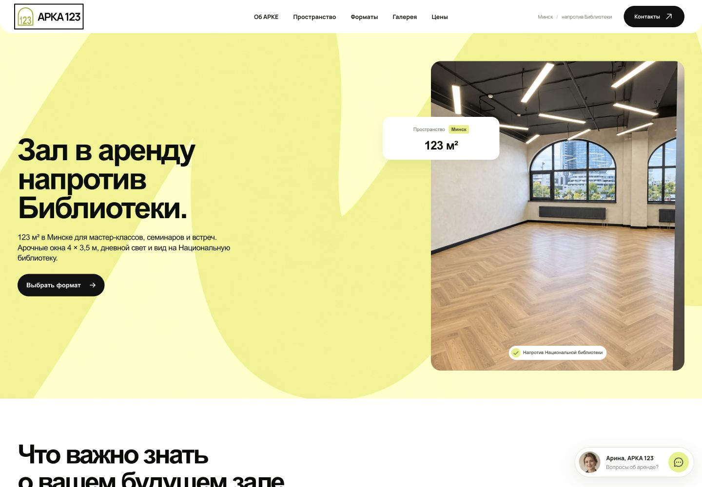
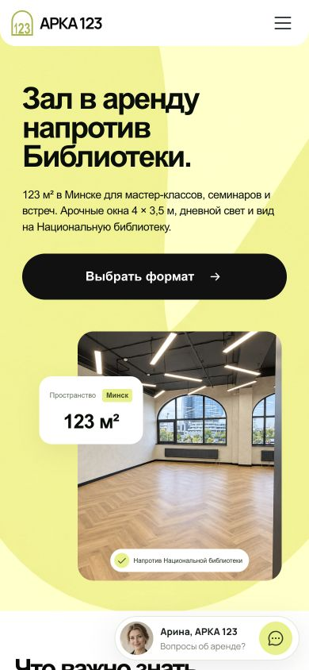
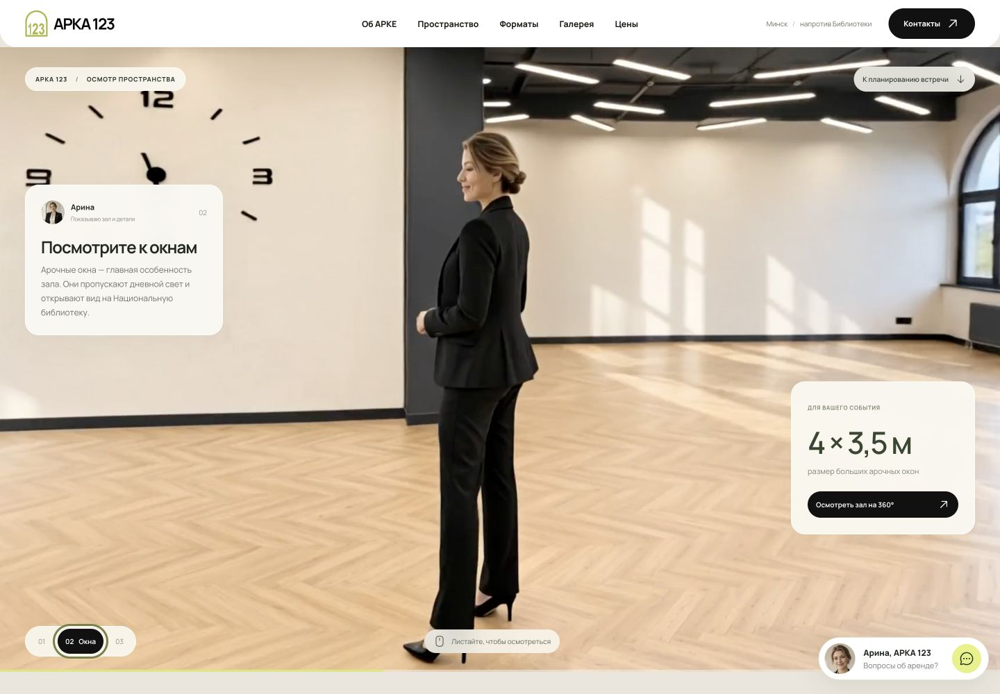
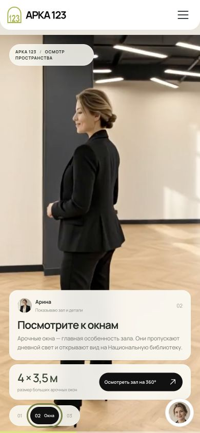
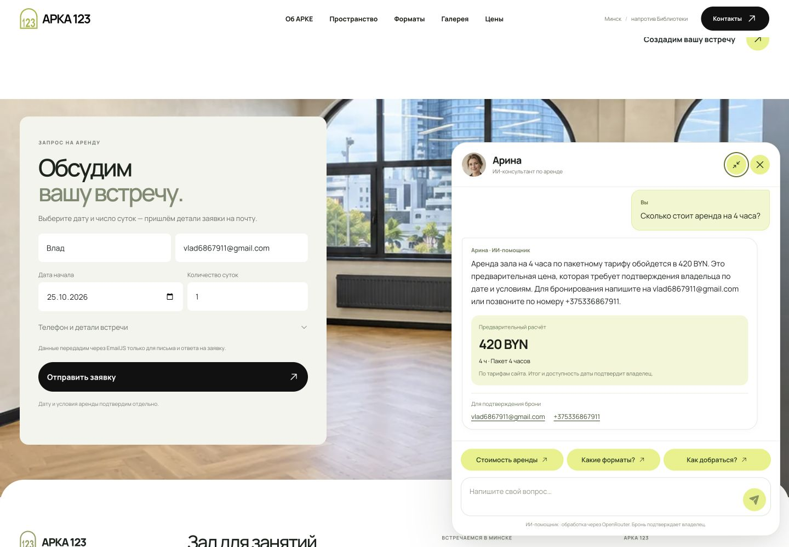
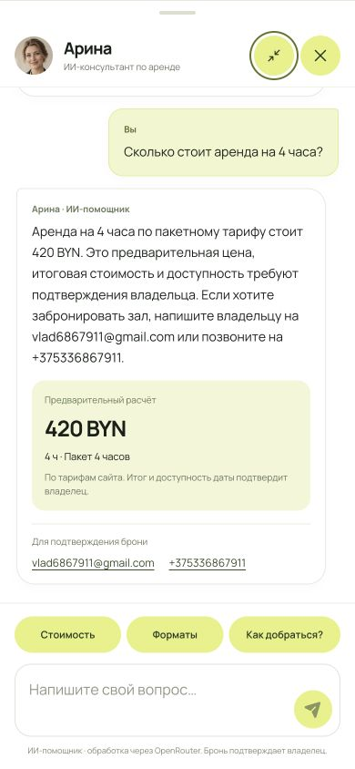
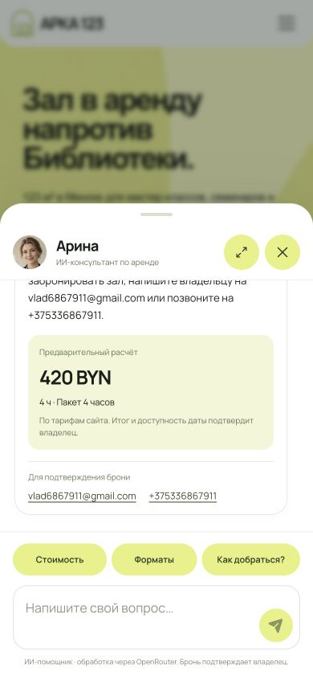
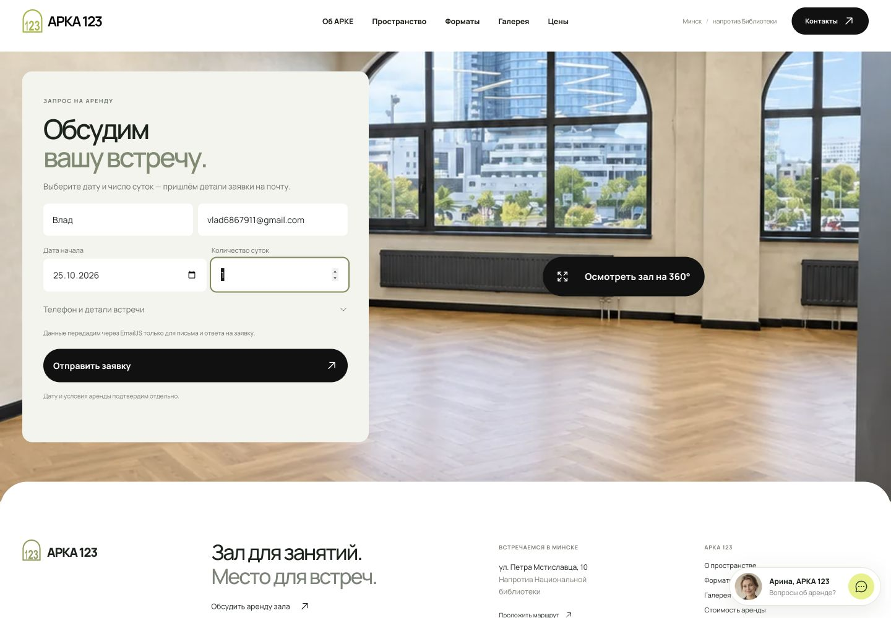
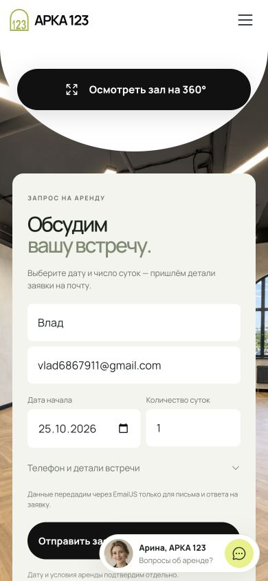
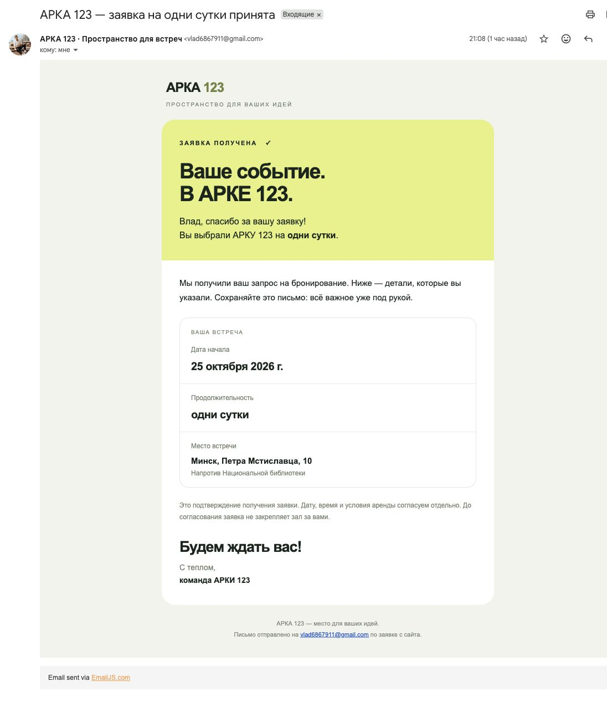

[**Открыть сайт АРКА 123 → arka-123-gold.vercel.app**](https://arka-123-gold.vercel.app/)

# АРКА 123 — место для ваших идей

Адаптивный сайт пространства для мастер-классов, семинаров и встреч в Минске, напротив Национальной библиотеки. Проект объединяет архитектуру реального зала, собственный визуальный образ, анимацию при прокрутке и работающие сценарии общения: консультацию с ИИ и заявку с письмом на почту.

## Концепция: сначала почувствовать пространство

АРКА — это и название, и главный образ проекта: арочные окна внутри зала, большая арка между домами снаружи, открытость новым встречам. Число **123** связано с площадью пространства — **123 м²**.

Идея сайта — провести посетителя от первого впечатления к своей будущей встрече. Сначала показать свет, масштаб и архитектуру, затем помочь представить формат события, осмотреть зал, разобраться в условиях и оставить заявку. Поэтому реальные фотографии соседствуют с концептуальными сценами, а Арина становится проводником по всему маршруту.

Визуальный язык строится на тёплом белом фоне, глубоком тёмном тексте, салатовом акценте **#e6f17e**, крупных заголовках и мягких скруглениях. Волнообразная лента на первом экране добавляет движение, фотографии передают характер помещения, небольшие плашки помогают быстро считать главное. Шрифт **Manrope** поддерживает спокойный, современный характер сайта.

## Дизайн: компьютер и телефон

Скриншоты сняты с работающей локальной версии проекта. Основные размеры презентации: **1440 × 1000** и **390 × 844 CSS px**.

| Десктоп · 1440 × 1000 | Телефон · 390 × 844 |
| --- | --- |
|  |  |

Полные снимки страницы в исходном размере: [десктоп](docs/images/desktop-full.jpg) · [телефон](docs/images/mobile-full.jpg). На статичных снимках сохраняется длина участков, отведённых под закреплённые скролл-сцены; их движение лучше смотреть на самом сайте.

<details>
<summary>Вся страница — десктоп</summary>


</details>

<details>
<summary>Вся страница — телефон</summary>


</details>

### Что меняется в адаптиве

Адаптация затрагивает композицию и взаимодействие, а не только размеры шрифта.

- **На широком экране** фотографии и текст располагаются рядом, тарифы и отзывы — в ряд. Вертикальная прокрутка управляет горизонтальной лентой пяти форматов.
- **На телефоне** блоки перестраиваются в одну колонку, навигация открывается боковой панелью. Форматы и отзывы листаются горизонтально; рядом с активным отзывом виден край следующего.
- Карта идёт перед компактной горизонтальной карточкой Google. Кнопки и чипы увеличены для касания, основная кнопка первого экрана выровнена по центру.
- Обзор интерьера **360°** занимает весь экран. В футере его кнопка встроена в белую дугу, продолжающую форму предыдущей секции.
- Чат превращается в нижний **drawer на 70% экрана**. Его можно развернуть, закрыть крестиком, нажатием на фон или потянуть за ручку вниз.
- Для экранной клавиатуры используется `visualViewport`: панель ограничивается доступной высотой, поле ввода остаётся над клавиатурой. Учтены `safe-area-inset-bottom` и размер текста ввода 16 px.
- При `prefers-reduced-motion` вступление пропускается, сложные анимации получают статичный или сокращённый вариант.

Основной переход мобильных секций — **760 px**; отдельные блоки используют дополнительные границы 360/380/420/520/600/900/1000/1100/1200 px. Для больших мониторов и невысоких ноутбуков есть отдельные правила. Это гибкая вёрстка между размерами, а не набор фиксированных макетов.

| Группа экранов | Размеры, учтённые в разработке и визуальных проверках |
| --- | --- |
| Компактные телефоны | 320 × 640, 320 × 780 |
| Основной мобильный размер | 390 × 844 |
| Большой телефон | 440 × 956 |
| Планшет | 768 × 1024, 1024 × 768 |
| Невысокий ноутбук | 1280 × 600, 1366 × 768 |
| Десктоп | 1440 × 900, 1440 × 1000, 1920 × 1080 |
| Большой монитор | 2560 × 1440 |

Матрица объединяет проверки разных этапов разработки. Свежие презентационные снимки находятся в `docs/images/`; предыдущие отчёты — в `work/qa/`. Поведение клавиатуры проверено расчётными тестами; проверка на физическом телефоне остаётся отдельным этапом.

## Скролл-сцена: камера обходит Арину

Один из центральных эпизодов сайта — полноширинная сцена, в которой прокрутка страницы управляет облётом камеры вокруг Арины в зале. Посетитель сам задаёт темп: прокручивает вниз — движение продолжается, возвращается вверх — камера идёт обратно, останавливается — кадр замирает.

| Компьютер | Телефон |
| --- | --- |
|  |  |

### Как создавалась сцена

1. **Зафиксировали героиню и помещение.** Стартовый кадр подготовлен во встроенном ImageGen с исходным портретом Арины и настоящей фотографией зала как референсами. Сохранялись лицо, одежда, брошь, арочные окна, паркет и освещение.
2. **Задали движение камеры.** В промпте отдельно описан полный круг: фронтальный вид → профиль → спина → второй профиль → возвращение к исходному ракурсу. Героиня остаётся на месте, меняется точка наблюдения.
3. **Сравнили итерации.** Через OpenRouter были созданы ролики **Kling v3.0 Pro** и **Google Veo 3.1**. В текущем интерфейсе выбран широкий вариант Kling: около 12 секунд, без приближения, файл `arina-orbit-wide.mp4`. Версия Veo в 1080p с приближением сохранена как отдельная итерация, но по умолчанию не используется.
4. **Подготовили локальное видео.** Просмотр не вызывает генеративный API: браузер работает с готовым MP4. Видео загружается при приближении к секции; до этого виден постер.
5. **Связали время видео со скроллом.** Закреплённая сцена находится внутри секции высотой `360svh`. Нормализованный прогресс прокрутки преобразуется в `video.currentTime`.

```text
прогресс = пройденная часть секции / доступная дистанция прокрутки
время видео = прогресс × (длительность видео − 0.05 секунды)
```

`requestAnimationFrame` объединяет обновления, а обработчик `seeked` применяет последнюю нужную позицию после завершения перемотки. `IntersectionObserver` ограничивает работу областью рядом со сценой, `ResizeObserver` помогает пересчитать геометрию при изменении окна.

Поверх ролика находятся настоящие HTML-карточки. Они переключают три главы — **«Зал», «Окна», «Расстановка»** — вместе с прогрессом движения. На компьютере карточки разнесены по бокам, на телефоне собраны снизу. При reduced motion, высоте окна до 500 px или ошибке видео остаются постер и ручное переключение глав.

Реализация: [ArinaScrollStory.tsx](src/widgets/ArinaScrollStory.tsx), [стили сцены](src/widgets/arina-scroll-story.css). [Исходный промпт движения](work/arina-scroll/orbit-video-prompt.txt).

## Арина: единый персонаж вместо разрозненных изображений


Для пространства, куда приходят учиться и работать вместе, выбран образ спокойной, уверенной и доброжелательной представительницы около 30–35 лет. Естественная внешность и сдержанная улыбка делают знакомство менее формальным; чёрный жакет и светлая блуза поддерживают деловой характер мастер-классов и семинаров. Брошь в форме арки с цифрами **123** связывает персонажа с фирменным знаком.

Арина появляется в нескольких ролях: знакомит с интерьером, помогает представить пять форматов событий, сопровождает скролл-сцену и отвечает в чате. Так один узнаваемый образ соединяет разные части сайта и делает переход от просмотра к вопросу естественным.

Для каждой новой сцены использовались **тот же портрет и фотографии того же помещения**. Это сохраняет преемственность лица, одежды и архитектуры. Текст, кнопки и информационные плашки выполнены в HTML/CSS и остаются читаемыми на разных экранах.

Арина — вымышленный персонаж. Сцены с участниками, видео, схема и интерьерная панорама созданы для концепта; реальные фотографии зала показаны отдельно. [Описание образа и промпт](docs/arina.md) · [Промпты пяти форматов](docs/format-arina-image-prompts.md).

## ИИ-консультант: диалог, знания и точный расчёт

Арина в чате — работающий ИИ-помощник на модели **Qwen3.7 Flash** (`qwen/qwen3.7-flash`), подключённой через **OpenRouter**. Она отвечает о пространстве, форматах и условиях, помнит контекст текущего разговора и помогает предварительно рассчитать аренду.

| Десктоп: плавающее окно | Телефон: развёрнутый чат |
| --- | --- |
|  |  |

<details>
<summary>Обычный мобильный режим — drawer на 70% экрана</summary>



</details>

### Как устроен запрос

```text
Чат в React → POST /api/chat → Node.js
                               ├─ системный промпт и база знаний
                               ├─ история текущего диалога
                               ├─ calculate_rental_quote
                               └─ OpenRouter / Qwen3.7 Flash → ответ в интерфейс
```

**Промпт собирается на сервере.** Он задаёт роль Арины, краткий дружелюбный тон, русский язык по умолчанию и текущую дату в часовом поясе Минска. Затем передаёт факты об объекте: площадь, адрес, окна, потолки, форматы и тарифы. Отдельный блок ограничивает обещания: не придумывать вместимость, оснащение, скидки и свободные даты; для подтверждения брони давать контакты владельца.

**Числа считает код.** Инструмент `calculate_rental_quote` рассчитывает длительность и стоимость. Для явно указанных часов сервер сразу передаёт модели готовый результат; для более сложного вопроса модель может вызвать инструмент. Например, вопрос «Сколько стоит аренда на 4 часа?» даёт **420 BYN** и отдельную карточку расчёта. Арина объясняет результат, а не заменяет калькулятор собственной арифметикой.

**Настройки ответа:** `temperature: 0.25`, до 1000 токенов, история до 14 сообщений. Проверяются роли и длины сообщений; ограничены частота запросов и число одновременных обращений. При ошибке сервиса показываются понятное сообщение, повтор и контакты.

На телефоне чат занимает 70% доступного экрана, умеет разворачиваться и закрываться жестом за ручку. Быстрые вопросы остаются доступны после первого ответа. Переписка живёт в состоянии текущей страницы; приложение не сохраняет её на диск. Запросы обрабатываются внешним провайдером OpenRouter.

Агент не подключён к календарю, не принимает оплату и не создаёт бронь. Для согласования даёт **vlad6867911@gmail.com** и **+375 33 686-79-11**. База знаний и промпт: [knowledge.ts](server/knowledge.ts); обработка и вызов модели: [chat.ts](server/chat.ts).

## Форма заявки и письмо на почту

Заявка — продолжение визуального стиля сайта: настоящая фотография зала, светлая карточка, крупный заголовок и понятные поля. Основной сценарий короткий: **имя → e-mail → дата → количество суток**. Телефон и комментарий раскрываются по желанию.

| Форма на компьютере | Форма на телефоне |
| --- | --- |
|  |  |

### Что подключено

Используется **EmailJS REST API**, сервис **Gmail**, подключённый владельцем через Google, и собственный HTML-шаблон письма. Браузер отправляет параметры заявки в EmailJS, а подключённый почтовый сервис доставляет письмо на e-mail, указанный в форме. В демонстрации используется **vlad6867911@gmail.com**.

```text
Форма → проверка полей → EmailJS → подключённый Gmail → письмо заявителю
```

Проверяются существующая дата не раньше сегодняшней по Минску, корректность e-mail, имя и целое количество суток от 1 до 365. Во время отправки повторное нажатие блокируется; есть скрытое поле против простых ботов и пауза между отправками. Успех появляется только после успешного ответа EmailJS, ошибка не подменяется сообщением об отправке.

### Что получает посетитель

Письмо повторяет фирменные цвета сайта: салатовый первый блок, белая карточка деталей, крупная типографика и мягкие углы. В нём есть обращение по имени, выбранная дата, продолжительность с русским склонением, адрес, комментарий при заполнении и завершение **«Будем ждать вас!»**.

Пример фактически полученного письма:

> **Тема:** АРКА 123 — заявка на одни сутки принята
>
> Влад, спасибо за вашу заявку! Вы выбрали АРКУ 123 на **одни сутки**.
>
> **Дата начала:** 25 октября 2026 г.
>
> **Место:** Минск, Петра Мстиславца, 10, напротив Национальной библиотеки.
>
> **Будем ждать вас!** С теплом, команда АРКИ 123.

Письмо подтверждает **получение заявки**. Дата, время и условия согласуются отдельно; автоматической проверки занятости и закрепления зала в этом сценарии нет.



[HTML-шаблон письма](emails/booking-confirmation.html) · [валидация и отправка](src/shared/lib/booking-email.ts) · [компонент формы](src/widgets/ContactForm.tsx).

## Логотип: название превращается в движение

Знак построен как **арка с цифрами 123 внутри**. Контур повторяет архитектурный мотив объекта, цифры связывают его с названием и площадью зала. SVG сохраняет чёткость в шапке, прелоадере и на мобильном экране.

Анимация раскрывает саму идею названия: сначала прорисовывается арка, затем по очереди появляются **1 → 2 → 3**, после — название и слоган. Контур рисуется через `stroke-dasharray` / `stroke-dashoffset`, цифры поднимаются с небольшими задержками. Это делает знак частью знакомства с пространством.

Чёрный прелоадер длится до **6 секунд**, его можно пропустить. Клик по логотипу в шапке повторяет фирменную анимацию и возвращает к началу страницы. Для reduced motion вступление автоматически пропускается. Финальная подсветка была убрана в процессе итераций, чтобы оставить более спокойное завершение.

Реализация: [ArkaMark.tsx](src/shared/ui/ArkaMark.tsx), [IntroPreloader.tsx](src/widgets/IntroPreloader.tsx), [CSS-анимации](src/shared/styles/global.css).

## Технологии и инструменты

| Задача | Что использовано |
| --- | --- |
| Интерфейс | **React 19**, **TypeScript 6**, **React Router 7** |
| Сборка и разработка | **Vite 8**, npm |
| Оформление | Собственные CSS, Grid, Flexbox, `clamp()`, media queries, CSS-анимации |
| Типографика и иконки | Manrope Variable, Phosphor Icons, собственный SVG-логотип |
| Скролл и взаимодействие | `requestAnimationFrame`, `IntersectionObserver`, `ResizeObserver`, нативные `dialog`, Pointer Events |
| Интерьерный обзор 360° | **Three.js**, WebGL, панорамное изображение, управление мышью/касанием/клавишами |
| Расположение | **Google Street View** и ссылки Google Maps |
| ИИ-консультант | **Node.js 24+**, серверный `/api/chat`, **OpenRouter**, **Qwen3.7 Flash** |
| Письма | **EmailJS REST API**, подключённый **Gmail**, адаптивный HTML-шаблон |
| Изображения | Встроенный **ImageGen** с референсами персонажа и настоящего помещения; экспорт в WebP |
| Генерация видео | **Kling v3.0 Pro** и **Google Veo 3.1** через OpenRouter; на сайте выбран широкий ролик Kling |
| Написание кода | **OpenAI Codex**: разработка React/TypeScript, итерации по обратной связи, интеграции и проверки |
| Контроль качества | TypeScript, **Oxlint**, **Node Test Runner**, визуальные проверки в браузере |
| Репозиторий и демо | Git / GitHub; опубликованное демо — Vercel |

ИИ использовался в двух разных задачах: **при создании проекта** — для кода и визуальных материалов; **во время работы сайта** — для ответов Арины. Изображения и видео заранее подготовлены и лежат в проекте, новые генерации при просмотре не запускаются.

## Запуск проекта

Нужен **Node.js 24+**.

```bash
npm ci
cp .env.example .env.local
npm run dev
```

Адрес локального сайта Vite выводит в терминал. Проверки и production-запуск:

```bash
npm run lint
npm test
npm run build
npm start
```

`npm test` запускает **17 тестов**: API чата, калькулятор, валидацию и отправку письма, геометрию мобильного drawer и пороги закрытия жестом. Отдельная проверка формы — `npm run test:booking`.

`npm start` обслуживает сборку и API на Node.js; по умолчанию — `http://127.0.0.1:3000`. `HOST` и `PORT` можно задать в окружении. В разработке и preview API подключается через конфигурацию Vite. Для чата на хостинге нужен серверный обработчик `/api/chat`: одной публикации статических файлов недостаточно.

### Переменные окружения и ключи

**Реальные ключи не хранятся в исходниках, README или Git.** `.env`, `.env.*` и `.env.local` исключены через `.gitignore`; в репозитории остаётся только `.env.example` с пустыми значениями и пояснениями.

В `.env.local` задаётся публичная конфигурация браузерных интеграций:

```dotenv
VITE_EMAILJS_SERVICE_ID=default_service
VITE_EMAILJS_TEMPLATE_ID=
VITE_EMAILJS_PUBLIC_KEY=
VITE_GOOGLE_MAPS_EMBED_API_KEY=
VITE_ARINA_ORBIT_VIDEO_URL=
```

`VITE_`-переменные попадают в клиентскую сборку. Поэтому здесь допустим **только публичный ключ EmailJS**, который предназначен для браузера; пароль Gmail, OAuth-токены и приватный ключ EmailJS не нужны. Необязательный браузерный ключ Google Maps Embed ограничивается разрешёнными доменами и API. Пустой URL видео оставляет встроенный локальный ролик.

Секретный ключ OpenRouter задаётся **только на сервере**:

```dotenv
OPENROUTER_API_KEY=
OPENROUTER_MODEL=qwen/qwen3.7-flash
```

На локальной машине сервер читает переменные процесса или приватный файл `~/.config/arka123/server.env` вне проекта. Другой путь задаётся через `ARKA_CHAT_ENV_FILE`. На хостинге используйте серверные переменные окружения. Для `OPENROUTER_API_KEY` нельзя использовать префикс `VITE_`: ключ не должен попадать в браузер или сборку.

После изменения клиентских переменных нужно перезапустить Vite или пересобрать проект. Без настройки EmailJS форма сообщает, что отправка не подключена; без серверного ключа чат показывает недоступность сервиса и контакты.

## Структура проекта

```text
src/app/             маршруты и общий макет
src/pages/           главная и страница 404
src/widgets/         секции, скролл-сцена, чат, форма, галерея, тур
src/shared/ui/       SVG-знак АРКА 123
src/shared/lib/      отправка письма и геометрия drawer
src/shared/styles/   общие стили и адаптация
server/              API Арины, промпт, база знаний и калькулятор
tests/               тесты письма и мобильного drawer
emails/              HTML-шаблон подтверждения заявки
public/images/       фотографии, персонаж и подготовленные сцены
public/videos/       локальные ролики для скролла
docs/images/         скриншоты для этого README
docs/                контекст проекта, описание образа и промпты
work/                исходники генераций и материалы визуальных проверок
```

Проект выполнен как тестовая концепция. Тарифы, рейтинг 5.0 и отзывы — демонстрационные данные, рейтинг не синхронизируется с Google. Схема и панорама не заменяют обмерный план. Форма подтверждает получение заявки; итоговые условия аренды согласуются с владельцем.
